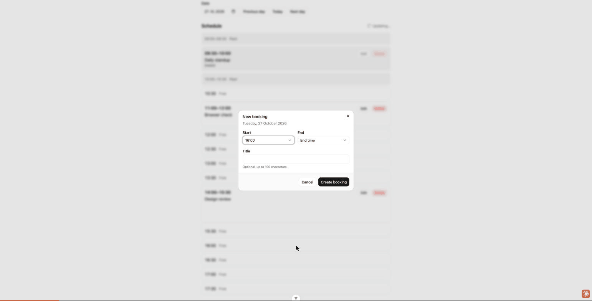

# Meeting Room Booking

A single-page app for booking one meeting room during the working day (09:00–18:00): pick a
date, see that day's bookings, and create, edit or delete a booking. The business rules live in
one pure function shared by the UI and a mock server (MSW), which also simulates real-world
failures such as a slot being taken by someone else. Vue 3.5, TypeScript (strict), Feature-Sliced
Design.

- **Live demo:** _to be added_
- **Repository:** _to be added_
- **Docs:** [Task](docs/TASK.md) · [Implementation steps](docs/STEPS.md) · [Conventions](docs/CONVENTIONS.md)

## For reviewers: 2-minute tour

1. **Server conflict (rule 8):** open the live demo with `?simulateConflict=1`, click a free
   slot, choose an end time and press **Create booking**. The banner appears, the list refreshes
   with the booking that took the slot, and your input stays.
2. **A real conflict with two tabs:** open the same day in two tabs, start a booking for a free
   slot in tab A, book that slot in tab B, then submit in tab A: `409` without any flag.
3. **The rules:** [`src/entities/booking/model/rules.ts`](src/entities/booking/model/rules.ts),
   one pure `validateBooking` used by the form and the mock server.
4. **The API swap point:** [`src/entities/booking/api/`](src/entities/booking/api/):
   `bookingsApi.ts` is the interface the UI depends on; `httpBookingsApi.ts` is the one file to
   replace for a different backend. `VITE_API_MODE=http` turns the mock off.



## Quick start

Requires **Node 22.22 or newer** (`.nvmrc` pins 22.23.4; `.npmrc` has `engine-strict=true`).

```sh
nvm use            # or install Node >= 22.22
npm ci             # clean install from package-lock.json
npm run dev        # http://localhost:5173 (mock API in the browser)
npm test           # unit, component and accessibility tests
npm run test:tz    # date tests in Asia/Dubai and America/Los_Angeles
npm run build      # type-check + production build into dist/
```

Other scripts: `npm run lint` (oxlint + ESLint + Steiger), `npm run type-check`, `npm run preview`.

## What's done

| TASK.md: the user can… | How |
|---|---|
| Select a date | Date input with Previous day / Today / Next day. The date is kept in `?date=YYYY-MM-DD` (shareable; invalid values fall back to today). |
| View bookings for the date | 09:00–18:00 day view: a timeline on desktop, a stacked list on mobile. Free time is shown as 30-minute slots. |
| Choose start and end times | Selects on a 15-minute grid. End options are limited to start + 30 min … start + 2 h, capped at 18:00. Past start times are disabled today. |
| Create a booking | "New booking", "Book a slot", or click a free slot (prefills the start time). |
| Edit a booking | Same form, prefilled. Bookings that have started are locked. |
| Delete a booking | Confirmation dialog showing the date, time and title. |

UI states: loading skeleton, empty state, error state with Retry, "Updating…" while refetching,
submitting (button disabled with a spinner), success toasts.

## Business rules

| # | Rule (TASK.md) | Domain rule (`entities/booking/model/rules.ts`) | Mock server | UI |
|---|---|---|---|---|
| 1 | Within 09:00–18:00 | `startsWithinWorkingHours`, `endsWithinWorkingHours` | `400 OUTSIDE_WORKING_HOURS` | Start options 09:00–17:30, end ≤ 18:00 |
| 2 | `start < end` | `isStartBeforeEnd` | `400 START_NOT_BEFORE_END` | End options always after the start |
| 3 | At least 30 min | `isLongEnough` | `400 TOO_SHORT` | End options from start + 30 min |
| 4 | At most 2 h | `isShortEnough` | `400 TOO_LONG` | End options up to start + 2 h |
| 5 | No overlap (touching is fine) | `isFreeSlot` via `isOverlapping` (half-open intervals) | `409 CONFLICT` | Error on the Start field; free slots only where 30 min fit |
| 6 | No past time; past dates view-only | `isNotOnPastDate`, `startsNotEarlierThanNowToday` | `400 IN_THE_PAST`; `400 ALREADY_STARTED` on edit/delete of a started booking | Past time greyed out and labelled "Past"; past dates show "Past dates are view-only" and no create button; the clock ticks every 30 s |
| 7 | An edit does not conflict with itself | `validateBooking(draft, existing, now, editingId)` | `PATCH` passes the booking's id | The form passes `editingId` |
| 8 | Server conflict even if the UI thought the slot was free | — | Real (two tabs) or simulated `409` | Refreshes the list, shows a banner, keeps the input, re-validates so the overlap shows on Start, focuses Start |

The form runs the same `validateBooking` as the server (via a zod schema), so most mistakes are
caught before a request is sent; the server is still the source of truth.

## Demo guide

All switches work in `npm run dev` and in the production build (mock mode). They are read when
the page loads and can be combined, e.g. `?slow=1&simulateConflict=1`.

| Try | What happens |
|---|---|
| `?simulateConflict=1` | The next valid create/edit: the mock server first saves a "Booked by someone else" booking in that slot, so the request gets `409`. |
| `?simulateError=1` | List requests fail with `500` for 5 s after load. The client retries once, then shows the error state; **Retry** after that works. |
| `?slow=1` | Every response takes 2–4 s: skeleton, submit spinner and "Updating…" are easy to see. |
| Two tabs, real 409 | Open the same day in two tabs. In tab A fill in "New booking" for a free slot; in tab B book the same slot; submit in tab A. |
| Two tabs, real 404 | In tab A open **Edit**; in tab B delete that booking; save in tab A. The form offers **Create as new booking**. |
| Reset demo data | Button below the schedule (mock mode only). Clears the saved bookings and reloads with the seed data; other tabs switch too. |
| A past date | **Previous day**, or `?date=` with a past day: bookings are listed as "Ended", nothing can be created or changed. |

Demo data is kept in `localStorage` (`mrb:bookings`) and seeded around today.

## Architecture

Feature-Sliced Design. A layer imports only from layers below it, other slices only through
their `index.ts`, and every import uses the `@/` alias. Rules: [`docs/CONVENTIONS.md`](docs/CONVENTIONS.md).

```
app        providers (Vue Query, BookingsApi, error handler), styles, App.vue
  ↓
pages      booking-day            composes everything, owns which dialog is open
  ↓
widgets    booking-timeline       day view, states, timeline segments
  ↓
features   booking-form · delete-booking · select-date      (mutations live here)
  ↓
entities   booking                model (types, validateBooking) · api (BookingsApi,
  ↓                               HTTP client, zod DTOs, useBookingsQuery) · config · ui
shared     api (httpRequest, typed errors) · lib/time · lib/clock (useNow) · ui · config

mocks      outside the layers, dev/demo only: MSW handlers, store, demo switches, test harness
```

- **Data flow:** component → composable (Vue Query) → `BookingsApi` (injected) → `fetch` →
  MSW in the browser (mock mode) or a real server (http mode).
- **Nothing in the app imports `mocks/`.** Only `main.ts` loads it, dynamically and only in mock
  mode (`enableMocking()`); the tests use it as their backend. Removing it means deleting
  `src/mocks` and `enableMocking()`, plus moving the tests to another backend.
- **Switching to a real API:** build with `VITE_API_MODE=http` and
  `VITE_API_BASE_URL=https://api.example.com`. MSW is not started; requests follow the same
  contract (`GET/POST/PATCH/DELETE /api/bookings`). For a backend with a different contract,
  replace one file, `entities/booking/api/httpBookingsApi.ts`, which implements the
  `BookingsApi` interface the UI depends on.

## Key decisions

<details>
<summary>Decision — why (11 decisions)</summary>

| Decision | Why |
|---|---|
| Vue 3.5 (pinned `~3.5`), not 3.6 | 3.6 / Vapor mode is not stable yet; the take-home should run on stable releases. |
| Feature-Sliced Design, checked by Steiger | Clear dependency direction; the business rules and the API stay independent of the UI. |
| TanStack Vue Query | Loading, error, retry and cache invalidation without hand-written state. Queries retry once and only on network/5xx; writes never retry. |
| MSW as the mock backend | Runs in the browser, so it also works on a static host (Vercel/Netlify) where a serverless in-memory store would reset. |
| One `validateBooking` for UI and server | The rules cannot drift; the server stays authoritative. |
| zod only at the boundaries | Request bodies, API responses and `localStorage` are validated once; everything inside trusts its types. |
| No optimistic updates | A booking is a scarce resource; showing a slot as yours before the server agrees would hide conflicts. |
| Injected clock (`useNow`) | Rules take `now` as a parameter; tests are deterministic and "now" moves forward while the page is open. |
| `role="alert"` for blocking problems, polite for the rest | Conflict / 404 / server errors stop the user's task, so they are announced immediately; toasts, "Updating…" and loading are polite. |
| Native `<select>` for times | Keyboard, screen readers and mobile pickers work out of the box. |
| `@/` alias only | Imports read the same everywhere and survive file moves; enforced by ESLint. |

</details>

## Assumptions (pending confirmation)

Questions sent to the team on 2026-10-27; these are the working assumptions until answered.

- **Time step:** 15 minutes. The UI uses the grid; the server does not enforce it.
- **"Today":** the user's local time zone.
- **Started bookings:** a booking that has started or ended cannot be edited or deleted.
- **Title:** optional everywhere; an empty title clears it; at most 100 characters.
- Starting in the current minute is not "past" (12:00 is bookable at 12:00:30).
- Bookings are half-open intervals: 10:00–11:00 and 11:00–12:00 do not overlap.
- If a draft is both invalid and overlapping, the server answers `400` (fix the input first), not `409`.

## Accessibility and testing evidence

<details>
<summary>axe on 4 states, contrast numbers, keyboard and focus, 198 tests</summary>

**Automated**
- 198 tests in 26 files (Vitest): business rules, time helpers, mock server handlers, the HTTP
  client and error mapping, composables against the real handlers, components, and the full page.
- `npm run test:tz` runs the date and rule tests in UTC+4 and UTC−7/−8, including 01:30 and 23:30
  local time; a guard test fails if the run is ever in UTC, where a `toISOString` bug would pass.
- **axe-core** on the real page in four states (day view with past/started/upcoming bookings,
  booking form open, delete confirmation open, error state): 0 violations. Verified that the
  setup catches problems by planting an unlabelled input, an image without `alt` and an empty
  button: all three were reported.
- **Tests proven by breaking the code:** removing the re-validation after a `409` makes the
  conflict test fail; making the form clear itself after an error makes the page conflict test fail.

**Checked in Chrome**
- Contrast (WCAG AA), before → after:

  | Element | Before | After |
  |---|---|---|
  | "Past" / "Ended" labels on grey | 4.35 | 5.77 |
  | Delete button text | 3.31 | 4.58 |
  | Focus indicator vs. white | 2.58 | 19.8 |

- Keyboard: every action works without a mouse; dialogs trap focus, close with Esc and return
  focus to the element that opened them (or the page heading if it no longer exists); a failed
  submit moves focus to the first field with an error.
- Labels on every control; errors linked with `aria-describedby`; status is text, not only color.
- No horizontal scroll at 320 px and 375 px; dialogs scroll inside a short landscape viewport.
- `prefers-reduced-motion` turns animations off; the tab title names the selected day.

</details>

## Not done / what I'd do next

- **Time zones with a real backend:** "today" is the browser's local day. A real server needs the
  user's (or the room's) time zone to judge "past".
- **15-minute grid not enforced server-side:** the API accepts 10:07; only the UI keeps to the grid.
- **Steiger `insignificant-slice` warnings (4):** in a one-page app every feature and widget has a
  single reference, which the rule suggests merging. Kept separate on purpose.
- **No end-to-end tests:** next would be a few Playwright flows (create, conflict, delete) against
  the preview build.
- **No i18n:** English only; dates use a fixed English format.
- One room, no authentication (out of scope per TASK.md).

## Deployment (Vercel)

Not deployed yet. Settings for a Vercel project:

| Setting | Value |
|---|---|
| Framework preset | Vite |
| Install command | `npm ci` |
| Build command | `npm run build` |
| Output directory | `dist` |
| Node.js version | 22.x (matches `engines: >=22.22.0`) |
| Environment variable | `VITE_API_MODE=mock` |

No rewrites are needed: there is one route, and the state is in the query string. The build
includes `public/mockServiceWorker.js`, which MSW needs in production.

## Time spent

About 1 h 45 min including planning (09:09–10:55), with AI assistance.

## AI-assisted workflow

I used AI as a pair programmer, with me owning the decisions and the review.

- **Tools:** Claude (chat) for planning, architecture and code review;
  Claude Code (terminal) for implementation, tests and browser checks.
- **Plan first:** translated the brief, wrote a step-by-step plan
  ([docs/STEPS.md](docs/STEPS.md)) and chose the stack before any code was written.
- **Standards defined up front:** architecture (Feature-Sliced Design), code style
  (simple, no clever patterns), `@/` imports, TypeScript and Vue 3.5 rules, all written
  into [docs/CONVENTIONS.md](docs/CONVENTIONS.md), which the implementation follows.
- **Small, reviewable steps:** each step ran as a separate prompt, ended with a report,
  and was reviewed before the next one. See the commit history.
- **Challenging the output:** I questioned and changed AI choices where they didn't fit,
  e.g. replacing writable `computed` with `defineModel`, limiting `v-bind` spreads to
  generated UI primitives, and adopting stable Vue 3.5 APIs instead of 3.6 RC.
- **Verification over trust:** tests were proven by deliberately breaking the code,
  the accessibility checks were proven with planted violations, and a clean
  `npm ci` on the pinned Node caught a lockfile problem before deploy.
- **Boundaries:** the AI never deployed, pushed or signed in to any service;
  those steps were done by me.

Transcripts (complete, unedited): [Claude chat](…) · [Claude Code session](…)
